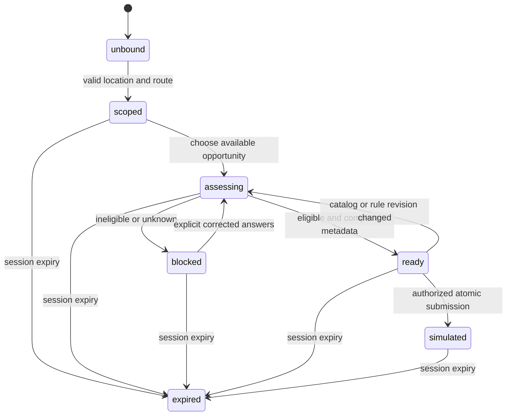

# Module boundaries and state — arkham

## Responsibilities

The proposed separation keeps location routing and submission authorization on the server. These are logical modules, not evidence of services currently deployed. A single process is a reasonable initial implementation; network separation is unnecessary to satisfy the invariants.

| Module | Inputs and owned state | Outputs and restrictions |
| --- | --- | --- |
| Location intake | Transient coordinate, accuracy, permission state | Validated routing input; do not put raw coordinates in logs or durable catalog records. |
| Session scope | Routing policy revision, server clock, route result | Session reference, immutable base, expiry and revision. Only this module creates/revokes scope. |
| Opportunity catalog | Session base and catalog revision | Available opportunities and required categories for that base. Never accepts client table names. |
| Eligibility evaluator | Opportunity revision, explicit answers, rule revision | Tri-state decision and stable reason codes. Pure evaluation cannot submit or mutate the base. |
| Demo document checker | Required categories and metadata | Size/MIME/category errors. It receives no document bytes and makes no authenticity claim. |
| Application coordinator | Authorized session, expected revision, idempotency key | Atomic simulated receipt or structured failure; real receiving feature gate fails closed. |
| Journey presenter | Server snapshot and localized copy | Accessible progress, reasons and retry choices; client step number has no authority. |

Use an adapter boundary for catalog and rule reads so deterministic synthetic fixtures can be substituted. No adapter may translate `unknown` to `eligible`. Compare expected revision inside the same logical transaction as receipt creation. If a persistent store is later introduced, implement either conditional writes or a transaction; checking a revision and writing separately permits a race.

## State transitions

All active states may be cancelled; cancellation revokes the session and ends its journey. `simulated` is terminal for that submission key; subsequent matching retries read the receipt. `expired` requires an explicit new session. Do not resurrect an expired session from a client snapshot. An opportunity selection change within the same base clears eligibility and document readiness; changing the base requires a new session.

## Contract and commands

The [snapshot schema](../contracts/onboarding-snapshot.schema.json) describes a proposed internal synthetic snapshot, not the payload of the existing `POST /api/session` example. Commands must use only their permitted input subset; never accept the whole snapshot as an authorized client write. Use proposed commands `startSession`, `selectOpportunity`, `evaluateEligibility`, `validateMetadata`, `simulateApplication` and `cancelSession`. Every mutation includes an expected revision; conflict returns 409 and the presenter fetches a fresh snapshot.

The snapshot contract represents bound sessions; pre-session `unbound` is intentionally outside its shape. Each successful mutation advances `revision`. For submission, authorize origin and live session first, then look up an existing idempotency key. A matching accepted payload returns its stored receipt before checking the old expected revision; a changed payload conflicts. For a new key, compare current revisions before writing. Submission freezes the selected opportunity revision and normalized metadata fingerprint under the idempotency key. The same key is scoped to a session; two different keys for one already simulated selection must not create duplicate receipts. Authorization, expiry, base equality, rule currency and category completeness are semantic checks beyond JSON Schema. A matching MIME string cannot demonstrate that a file exists.

Use error envelopes containing `code`, `retryable`, `correlation_ref` and safe field paths. Suggested codes include `SESSION_EXPIRED`, `BASE_CONFLICT`, `LOCATION_UNAVAILABLE`, `ELIGIBILITY_UNKNOWN`, `CATALOG_CHANGED`, `METADATA_INVALID` and `REAL_RECEIVING_DISABLED`. Validate origin before performing mutations. Same-origin checking supplements session authorization; it does not replace it. Cookie attributes, CSRF protection, access controls and durable idempotency storage require a separate implementation review before any real exposure.

[Engineering index](index.en.md)
